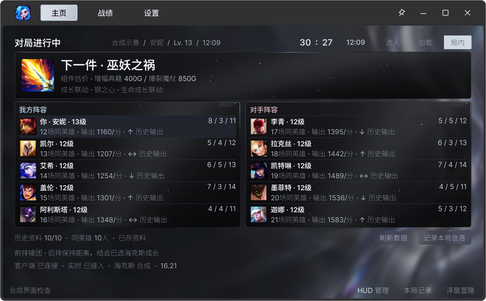

# 李金金 · 海克斯大乱斗助手

李金金是面向《英雄联盟》国服海克斯大乱斗的 Windows 桌面助手。选牌时可以查看强化条件和比较依据，进入对局后可以看下一件装备、还差多少金币，以及双方阵容。

*截图来自李金金的演示场景，使用模拟对局数据。*

## 对局中可以看什么

- **海克斯三选一** · 读取 WeGame 提供的候选记录，在卡位上方显示强化条件。数据足够时进行比较，缺少信息时标出缺项。
- **出装与阵容** · 根据当前英雄、装备和对局信息展示下一件装备、可买组件和金币差额。主窗口可查看双方阵容与对局阶段。
- **战绩与回看** · 查看已完成的海克斯对局、记分板和已有决策记录。

### 局内浮层

## 启动

便携版支持 Windows 10 1809 或更新版本及 Windows 11，系统需为 x64。

1. 将已有的 Windows x64 便携包完整解压到可写目录，双击 `李金金.exe`。
2. 登录国服客户端。进入海克斯大乱斗后，助手会随可用的客户端和对局数据更新。实时选牌提示依赖 WeGame 提供对应的候选记录。
3. 在「设置」里调整浮层、选牌提示和窗口关闭行为。关闭主窗口默认退出。运行中可按 `Ctrl + Alt + F6` 打开主窗口。

推荐分析在本机运行。可以在「设置 → 模型」里配置 DeepSeek 或兼容的本地模型，供可选的阵容分析使用。

李金金是独立开发项目。《英雄联盟》及相关游戏素材的权利归各自权利方所有。
