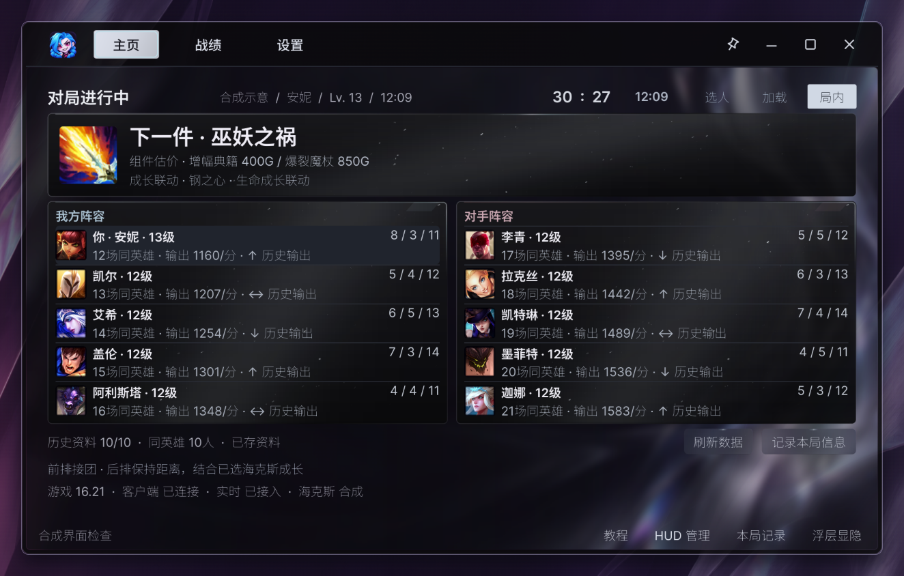
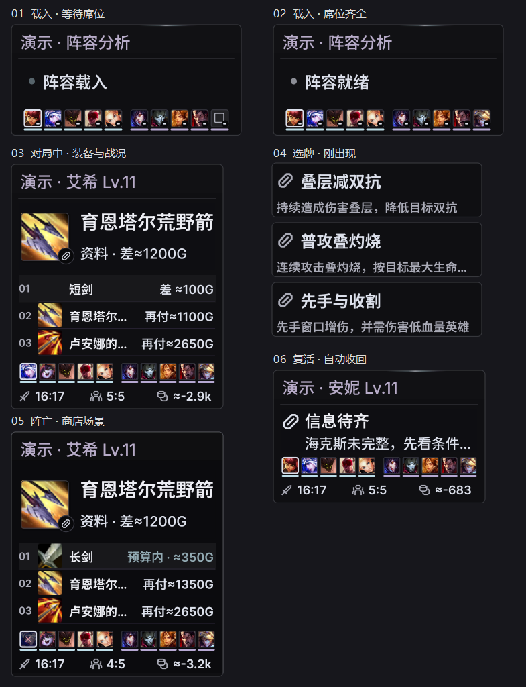
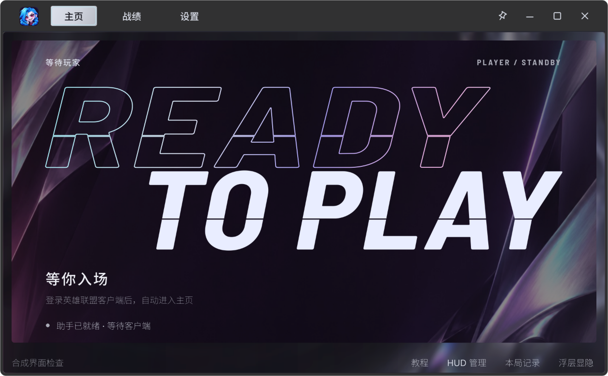

  

  

  <a href="#李金金是谁">李金金是谁</a> ·
  <a href="#对局中能看什么">对局中能看什么</a> ·
  <a href="#怎么启动">怎么启动</a> ·
  <a href="#源码与许可">源码与许可</a>

## 李金金是谁

他是我的好BRO，长得还蛮好看的。游戏理解是天才级别。跟他打海克斯，我还在读第一张牌，他已经讲到拿了这张第三件该出什么了。我有时候还没听懂，他已经讲下一张了。

他打游戏实在太厉害，我就给他蒸馏了。蒸出来一看，还是那么能 BB。

## 对局中能看什么

李金金是《英雄联盟》国服海克斯大乱斗的 Windows 桌面助手。三张牌弹出来时，可以看它们各自怎么触发。打到一半想买装备，可以看下一件做什么、手里的钱够买哪个组件。

*界面截图使用模拟对局数据。点击主窗口截图可查看原图。*

- **选牌** · 根据 WeGame 提供的三选一记录显示强化条件和比较依据。信息不全时会标出缺项。
- **出装和阵容** · 按当前英雄、装备和对局信息查看出装参考、可买组件和金币差额。主窗口同时展示双方阵容和对局阶段。
- **赛后回看** · 查看已完成的海克斯对局、记分板和已有决策记录。

### 局内浮层

浮层会随对局阶段切换。阵亡时可以看商店参考，复活后收回。

## 怎么启动

便携版支持 Windows 10 1809 或更新版本及 Windows 11，系统需为 x64。

1. 将 Windows x64 便携包完整解压到可写目录，双击 `李金金.exe`。
2. 登录国服客户端，进入海克斯大乱斗。实时三选一提示需要 WeGame 提供候选记录。
3. 在「设置」里调整浮层和选牌提示。默认关闭主窗口就退出。程序运行时，按 `Ctrl + Alt + F6` 可打开主窗口。

推荐分析在本机运行。如需额外的阵容分析，可在「设置 → 模型」里配置 DeepSeek 或兼容的本地模型。

## 源码与许可

本仓库公开了 Windows 助手的主窗口、局内浮层、本地推理和数据接入代码。可以用仓库里的合成数据构建并启动演示。[构建说明](BUILD.md)

自研代码采用 [MIT](LICENSE)。Qt 动态库、开源字体和游戏素材遵循各自条款。[第三方许可](THIRD_PARTY_NOTICES.md)

*李金金是独立开发项目。《英雄联盟》及相关游戏素材的权利归各自权利方所有。*
